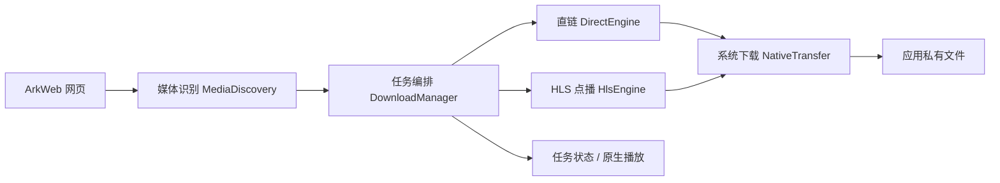

# Harmony Web Video Downloader

使用 **HarmonyOS 原生能力**实现的网页视频识别与下载示例：通过 ArkWeb 发现媒体资源，使用系统下载服务保存视频，并用系统播放器进行本地播放。

采用 ArkTS / Stage 模型，无第三方运行时依赖，不需要 KMP、FFmpeg 或外部视频解析服务。提供可替换的识别规则、请求头提供器及下载引擎，便于集成到已有应用。

> 当前定位是可运行、可扩展的示例工程。已在模拟器验证单个抖音视频的打开、识别、直链下载与本地播放；不保证所有站点或视频均可下载。请仅下载你拥有权利或已获得授权的内容，遵守站点规则。本项目不提供 DRM 绕过功能。

## 功能

- **网页识别**：结合网络请求、网页下载事件及页面脚本，发现 video/source、页面资源和部分站点数据中的视频地址。
- **分享文案**：从完整分享文案中提取 HTTP(S) 链接；旧版抖音视频分享落地页自动转换为同一视频的普通网页地址。
- **直链下载**：使用系统下载服务，支持进程内暂停、恢复、取消及 URL 去重；保存后使用系统媒体元数据提取器校验视频轨道。
- **HLS 点播**：选择清晰度与独立音轨，下载分片、初始化段及普通 AES-128 密钥；所有资源完成后发布本地播放列表。
- **任务管理**：进度及完成状态自动更新，完成记录重启后可见，删除文件前确认。
- **原生播放**：通过 HarmonyOS Video 组件播放已下载文件。
- **网络策略**：默认不允许计费网络或漫游，允许宿主显式配置。

## 环境

| 项目 | 要求 |
| --- | --- |
| 开发工具 | DevEco Studio，安装 HarmonyOS SDK |
| SDK | 当前工程 target API 20，compatible API 12 |
| 语言与模型 | ArkTS，Stage，ArkUI 状态管理 V1 |
| 设备 | HarmonyOS 手机、平板或 2in1；已在模拟器验证部分流程 |
| 权限 | INTERNET、GET_NETWORK_INFO |

当前验证使用 HarmonyOS 6.0 SDK（API 20）。最低兼容配置不代表已在 API 12 设备完成验证。真机安装前，需要在 DevEco Studio 中为自己的账号与设备配置签名；仓库不包含签名材料。

## 快速开始

1. 克隆仓库：

   ```sh
   git clone https://github.com/ljwx/harmony-web-video-downloader.git
   cd harmony-web-video-downloader
   ```

2. 使用 DevEco Studio 打开仓库根目录，完成 SDK 与工程同步，配置需要的本地签名。
3. 选择模拟器或设备运行 `entry` 模块。
4. 输入网页链接或粘贴完整分享文案，点击「打开」。如需要，在网页内登录并播放视频。
5. 等待自动识别，或点击「识别」，然后选择候选资源的「下载」。
6. 在任务列表查看状态，暂停、恢复、取消、播放或删除。

文件保存到应用私有目录 `filesDir/webvideo/<任务 ID>/`，不会自动写入系统相册。移动网络开关只影响之后创建的任务，下载不随网页切换而取消。

## 实现结构



```text
entry/src/main/ets/
├── entryability/EntryAbility.ets
├── pages/
│   ├── Index.ets                 # 浏览、识别与任务操作入口
│   └── DownloadTaskRow.ets       # 随状态快照更新的任务行
└── webvideo/
    ├── Index.ets                 # 公共导出
    ├── Contracts.ets             # 数据类型和引擎契约
    ├── PageAddress.ets           # 分享文案与视频页面地址处理
    ├── MediaDiscovery.ets        # 识别规则和按目标 URL 获取请求头
    ├── PageScript.ets            # 在 ArkWeb 中执行的页面提取脚本
    ├── DownloadManager.ets       # 统一任务入口、状态订阅及完成记录
    ├── NativeTransfer.ets        # 系统下载服务适配
    └── NativeEngines.ets         # 直链和 HLS 实现
```

## 接入 API

核心导出位于 [`webvideo/Index.ets`](entry/src/main/ets/webvideo/Index.ets)，示例中的 `context` 是 `common.UIAbilityContext`。下面代码应放入具备相应生命周期的宿主：

```typescript
import { DownloadManager, DefaultClassifier, TaskSnapshot } from './webvideo/Index';

const manager = new DownloadManager(context);
const unsubscribe = manager.subscribe((tasks: TaskSnapshot[]) => {
  // 将最新快照传入 UI 或通知层。
});

const candidate = new DefaultClassifier().classify(mediaUrl, mimeType);
const id = manager.start(candidate, {
  url: pageUrl,
  title: pageTitle,
  userAgent: browserUserAgent
}, {
  network: { metered: false, roaming: false, background: false },
  maxVideoHeight: 720,
  audioLanguage: 'zh'
});

await manager.pause(id);
await manager.resume(id);
await manager.cancel(id);
// 删除需要宿主先向用户确认。
await manager.remove(id);
unsubscribe();
```

这些操作展示接口用法，宿主应按任务状态和用户动作分别调用，并处理异常。

### 扩展点

| 接口 | 用途 |
| --- | --- |
| `DownloadManager(context, engines?, headers?)` | 注入引擎与请求头策略；传入引擎列表会替换默认列表，按列表顺序匹配 |
| `DownloadEngine.supports/create` | 接入新的媒体格式，无需复制页面和任务编排 |
| `DownloadJob.run/pause/resume/cancel` | 引擎执行及生命周期控制；返回最终文件或 HLS 包路径 |
| `HeaderProvider.headers(targetUrl, page)` | 为每个媒体资源、播放列表、分片、密钥分别生成请求头 |
| `CandidateClassifier` | 向 `MediaDiscovery` 注入站点识别规则 |
| `DownloadOptions` | 配置计费网络、漫游、后台参数、最大高度与音轨语言 |

默认请求头使用目标 URL 对应的 ArkWeb Cookie 与浏览器 UA，跨 origin Referer 仅携带来源 origin。宿主可以替换此策略。系统服务内部重定向时的头部转发仍需按目标站点验证。

建议宿主持有一个 `DownloadManager`，让界面与通知共用同一操作入口。退订仅移除监听，不取消任务。页面示例每 2.5 秒扫描一次，页面销毁时停止扫描。HLS 总大小未知时 `total=0`，不会伪造百分比。

## 支持范围与限制

| 场景 | 当前支持情况 |
| --- | --- |
| HTTP(S) 直链视频 | 系统下载；系统元数据校验失败时不报告视频完成 |
| HLS 点播 | master/media、相对 URL、清晰度、独立音轨、TS/fMP4 初始化段及普通 AES-128；输出本地 HLS 包，**不是合成 MP4** |
| 本地 HLS / AES-128 播放 | 下载逻辑有宿主模拟检查；系统播放器与真机兼容性未验证 |
| DASH、分片合成 MP4、转码 | 未实现，可扩展下载引擎 |
| 直播、字节范围 HLS、LL-HLS、SAMPLE-AES/DRM | 明确报能力错误 |
| blob URL | 识别但不直接导出；应选择同时发现的真实网络资源 |
| HLS 跨目录重定向 | 相对地址以原请求 URL 为基准；需提供最终播放列表地址 |
| 进程内暂停 / 恢复 | 复用系统任务，具体续传能力取决于服务器及系统 |
| 进程退出 / 重启 | 仅恢复完成记录，不重绑定未完成任务，没有跨进程断点恢复 |
| HLS 后台编排 | 未提供后台运行保障；`background` 仅透传到单个系统任务，示例默认关闭 |
| 图片、剪贴板通知、书签、媒体库同步 | 未包含 |

失败或取消的部分文件会保留，可通过任务的删除操作清理；进程退出后未记录的残留目录可通过应用设置清理存储。生产接入需要补齐未完成任务持久化与恢复。

Cookie 不写入完成记录，但完成记录包含来源 URL，可能带有签名参数，存储于应用私有目录。网站策略、登录状态和系统版本变化可能影响识别与下载结果。

## 构建与验证

macOS 使用 DevEco Studio 自带工具：

```sh
./scripts/build.sh

# 使用 DevEco 自带 Node.js 运行宿主回归检查。
/Applications/DevEco-Studio.app/Contents/tools/node/bin/node scripts/verify.cjs
```

- `build.sh` 默认使用 `/Applications/DevEco-Studio.app/Contents`，可通过 `DEVECO_APP_PATH`、`DEVECO_SDK_HOME`、`JAVA_HOME` 调整。
- `verify.cjs` 使用 DevEco 自带 TypeScript，可通过 `ARKTS_TYPESCRIPT` 指定该模块目录。
- 未配置签名时，构建产物为 `entry/build/default/outputs/default/entry-default-unsigned.hap`；它不等同于可安装到任意真机的签名包。
- 宿主检查用模拟系统服务执行核心源码，不是 Hypium、模拟器或真机测试。

已记录的验证结果：16 项宿主逻辑检查通过，ArkTS 编译打包通过，指定抖音短链接在模拟器完成识别、下载和本地播放。详见 [验证范围](docs/VALIDATION.md)。

## 常见问题

**粘贴完整分享文案后无法打开？**

当前版本会提取第一个有效 HTTP(S) 链接。确认使用最新代码；没有有效链接时会显示提示。仅对旧版抖音视频分享地址做规范化，不改写其他网站。

**网页能加载，但没有视频？**

尝试在网页内登录或播放后再识别。站点可能需要登录、采用不同数据结构，或限制嵌入式浏览器访问。网页加载成功不代表一定能发现媒体。

**为什么下载了 m3u8 却没有 MP4？**

HLS 引擎保存完整分片与本地播放列表，没有实现合成或转码。

**下载状态停在 preparing？**

任务尚未产生下载进度，也可能正在等待系统网络条件。保持允许的网络连接；检查系统日志与站点响应。任务行更新使用 `@Prop` 接收快照，已修复完成后需要手动切换列表的问题。

## 贡献与许可

欢迎提交 Issue 或 PR。报告问题时请提供 SDK / 系统版本、模拟器或设备信息、可公开的复现步骤与脱敏日志，不要上传 Cookie、登录令牌或签名证书。

采用 [MIT License](LICENSE)。第三方站点内容及相关商标不属于本项目许可证的授权范围。本项目与抖音及其他站点无隶属或合作关系。
